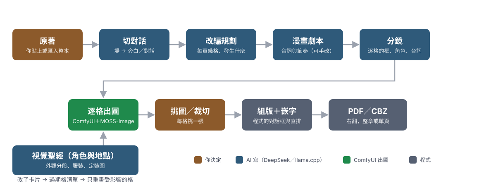

# 文字轉漫畫 text2comics

把小說改編成**日式黑白頁漫**的本機工具：文字端用 AI（DeepSeek 或本機 llama.cpp）寫規劃、劇本、分鏡，出圖交給 ComfyUI 的 MOSS-Image，嵌字與組版由程式完成，最後輸出右翻的 PDF／CBZ。

所有東西都在你自己的資料夾裡：稿件是純文字（Markdown＋YAML＋JSON），圖是 PNG。工具只在自己的電腦上跑（`127.0.0.1`），不會上傳你的稿子；只有你設定的 AI 服務會收到要改寫的那一章。



中間那幾步（切對話、規劃、劇本、分鏡、角色卡片）是 AI 做的；逐格出圖交給 ComfyUI；組版、嵌字與輸出是程式。

> 這份是給**使用者**看的說明；同一份內容另有一頁式網頁版 [README.html](README.html)。開發者與貢獻者請看 [技術說明](docs/技術說明.md)。

## 這個工具能幫你做什麼

它把「做一頁漫畫」拆成幾件可以分開做的事：原著、切對話、規劃、劇本、分鏡、出圖、嵌字、輸出。每一件都能單獨重跑，不會因為某一步不滿意就得全部重來。

### 它怎麼跟你分工

- **你**：決定畫風、哪一章、每一格要畫什麼、哪張圖留下、台詞怎麼改。所有「要不要」的決定都在你手上。
- **AI**：一次只做一件事——這次切這一章的對話、這次寫這一章的規劃、這次畫這一格。它讀的是你資料夾裡的真實檔案。
- **工具**：把 AI 的輸出轉成可以畫的提示詞（每一格一張圖）、送進 ComfyUI、把圖排成頁、把台詞嵌上去、輸出成檔案。AI 的草稿要你確認才會進定案。

## 開始之前，你需要

| 項目 | 說明 |
|---|---|
| Windows 10／11 電腦 | 目前只在 Windows 上實測（Python 3.10 以上） |
| Python | 3.10 以上；`start.bat` 第一次會自己建立虛擬環境並安裝套件 |
| ComfyUI ＋ MOSS-Image 模型 | 出圖用。需要 `unet`／`clip`／`vae` 三個模型檔（設定頁可以從 ComfyUI 的模型清單挑） |
| AI 服務（二選一） | DeepSeek 的 API 金鑰，或本機的 llama.cpp（OpenAI 相容網址） |
| 磁碟空間 | 模型本身數十 GB；每章出圖的候選圖也會佔空間（可以只留挑中的） |

沒有 GPU 也能先熟悉流程：新建專案時勾「複製範例《屋頂的便當》」＋「連同範例的出圖」，範例有現成的圖，可以一路走到頁面。

## 安裝

### Windows

1. 安裝 [Python](https://www.python.org/downloads/)（安裝時勾「Add python.exe to PATH」）。
2. 下載這個專案，放在任何資料夾。
3. 雙擊 **`start.bat`**。第一次會自動建立 `.venv`、安裝 `requirements.txt` 的套件（要幾分鐘），並提醒你複製 `config.json`。
4. 瀏覽器會打開 `http://127.0.0.1:8000`（被占用時會自動換下一個埠，終端機會印出實際網址）。

沒有 `config.json` 的話，把 `config.example.json` 複製成 `config.json` 就好；預設值可以用，之後在介面的「設定」頁改。

### 第一次啟動：先看「設定」頁的「環境」卡

| 要看什麼 | 怎麼處理 |
|---|---|
| ComfyUI 有沒有連上 | 先啟動 ComfyUI（預設 `http://127.0.0.1:8188`）；沒開的話出圖一定失敗 |
| 出圖 profile 的模型 | 按「從 ComfyUI 抓模型清單」，`unet`／`clip`／`vae` 用下拉挑；按「依 kind 自動挑」也可以。**同一臺 ComfyUI 一次只掛一組模型** |
| AI 有沒有金鑰 | DeepSeek：金鑰可以設環境變數 `DEEPSEEK_API_KEY`，或直接把金鑰貼進設定頁（存進系統金鑰庫，**不會寫進任何檔案**）；llama.cpp 是填網址 |
| 模型對不對 | DeepSeek 建議 `deepseek-flash`（快）與 `deepseek-v4-pro`（難題）；每個階段可以用不同 provider |

設定改完按最下面的「儲存」，會寫回 `config.json`（舊檔先備份成 `config.json.bak`）。按「測試連線」可以確認金鑰與模型名稱對不對。

## 內建範例專案（想先玩再動手）

專案裡有一個現成的範例：**`examples/sample_comic`**（《屋頂的便當》，一章 5 格，附兩個角色、一個地點）。公開下載的版本還附了**縮小過的範例出圖**，所以打開它就能一路走到「頁面」分頁下載 PDF／CBZ，不需要 GPU 也不用金鑰。

想從範例開一個能改的專案：左側「新建專案」→ 選資料夾 → 勾「複製範例《屋頂的便當》」與「連同範例的出圖」。

## 建立專案

一個漫畫專案就是**一個資料夾**。左側有三段：專案、目前的專案、系統。

- **新建專案**（`#/new`）：填資料夾路徑、作品名、畫風（日式黑白／彩色／美式著色），可以順便複製範例。按「建立」就會建好骨架資料夾。
- **開啟專案**（`#/projects`）：貼上資料夾路徑或瀏覽，右邊有「最近開過」。
- **總覽**（`#/project`）：章節表與各階段進度、畫風、**匯入整本切章**、視覺聖經摘要。

### 匯入整本小說（一次切好幾章）

總覽頁按「匯入整本切章…」：選 `.txt`／`.md`／`.docx`、選切章方式與編號，按「**預覽**」看章號、章名、字數（**預覽不寫檔**），確認後才按「匯入」。重複匯入預設跳過已有的章，要覆蓋就選「覆蓋（先備份舊檔）」。

## 做一章：七個分頁

章節頁（左側「第 N 章」）有七個分頁，照順序做就好。右上角是「整章批次」，可以一次跑完。

| 分頁 | 你做什麼 | 注意 |
|---|---|---|
| **原著** | 貼上這一章的小說，或從檔案匯入 | 一章一個檔（`source/chNNN.txt`）；字數與 token 估計會顯示 |
| **切對話** | 按「產生切對話」，把小說切成場 → 旁白／對話／演出 | 選用但建議做。每一句都回指原著段落，台詞逐字保留、漏掉的句子會自動補；右邊有忠實度報告 |
| **規劃** | 按「產生規劃」，AI 排每頁每格的節拍與刪減 | 可以指定頁數；可以手改 JSON（存檔前會檢查） |
| **劇本** | 按「產生劇本」，AI 寫成漫畫劇本（Markdown） | 這是最值得親手改的一層：台詞、節奏都在這裡 |
| **分鏡** | 按「產生分鏡」；表格逐格改，點一列開框編輯器 | 存檔前一定要能編譯；畫面上的框就是角色在這一格的位置 |
| **出圖** | 先選「出圖 profile」再選「出圖預設」，按「整章出圖」或「出這一格」 | 點縮圖就是選圖；可以裁切、加畫、同 seed 重畫 |
| **頁面** | 即時看組版＋嵌字的樣子，按「輸出頁面」寫出 PNG | 滿意就下載整章 PDF／CBZ，或到「嵌字」頁微調對話框 |

### 出圖這一步在忙什麼

程式把分鏡裡這一格的鏡頭、角色（外觀逐字來自視覺聖經）、場景、人數組成一段英文提示詞，連同這一格在頁面上的比例框，送進 ComfyUI。**一格一張圖**，不會整頁一次生成（整頁生成時角色常常跑錯格）。

台詞不會進提示詞——字是嵌字程式疊上去的，所以圖裡不該有字。

## 視覺聖經：讓角色長得一樣

這是整個流程裡最影響成果的一步。左側「視覺聖經」：

1. **掃描原著＋成卡**：讀 `source/` 的每一章，找出角色與地點，寫出卡片草稿（附原文引文）。也可以按「反推設定（整本掃描＋成卡）」，一次掃完整本、分批、可以中斷再續。
2. **看草稿**：草稿不會被分鏡使用。打開每一張看「待確認」——哪些外觀是模型補的、哪裡和作者設定衝突。
3. **確認入庫**：沒有錯誤的草稿可以按「確認入庫」，之後每一格都照它畫。
4. **定裝圖**：替角色出幾張標準圖（全身／胸像），挑一張當這個角色的樣子。

### 卡片長什麼樣：分段與服裝

外觀分成五段（頭部、身形、上半身、下半身、飾品），服裝分成上著／下著／套裝。**出圖時會按鏡頭只貼需要的段**：特寫只貼頭部，全身與遠景才貼下半身與下著。所以同一個角色的臉，在特寫與全身是同一段文字。

舊的卡片只有一整句外觀也能用，卡片頁上有「**拆成分段（草稿）**」，按一下會先幫你拆好，你看過、改過再按「儲存分段」。

### 改了卡片會怎樣：過期格清單

每一格出圖時會記下「用了哪幾段」。之後你改了某個角色的頭部、換了服裝、或換了畫風，視覺聖經首頁就會出現「**有 N 格過期**」，寫出是哪個角色的哪一段改了，並且可以「**只重畫這些格**」。

重畫會用同一批 seed 覆蓋同一批檔名（所以挑圖紀錄不用重做），舊圖會先備份到專案的 `build/render/backup/`。

### 探索用：還沒建卡也可以先看

角色還沒有卡片時也可以出圖，但那些格會標成「**探索用**」：不能選圖、不進頁面、也不算過期。等卡片補上再正式出圖，才不會分不清哪張能用。

## 整章批次與顯示卡

右上角「整章批次」可以一次勾選要跑的階段（切對話 → 規劃 → 劇本 → 分鏡 → 出圖 → 頁面），已經有的檔案會跳過；勾「重做已有的」才會覆蓋前面的階段。出圖永遠只補沒畫過的格。

用**本機 llama.cpp** 寫文字時，文字跑完、要開始出圖之前，工具會請你關掉 llama-server 釋放 VRAM（也可以選「已關閉，繼續」）。用 DeepSeek 時不會問。任務在右邊的「任務」面板排隊，一次只跑一個。

## 一本漫畫在硬碟上長什麼樣

```
我的作品/
  project.yaml        這部作品的名字、畫風、閱讀方向、出圖參數
  source/ch001.txt    原著（一章一個檔）
  scenes/ch001.json   切對話（場 → 旁白／對話／演出）
  plan/ch001.json     改編規劃（每頁幾格、發生什麼事）
  script/ch001.md     漫畫劇本（人看的，可以手改）
  storyboard/ch001.json  分鏡（機器讀；介面可以編）
  bible/characters/*.md  角色卡（外觀分段、服裝）
  bible/locations/*.md   地點卡
  bible/drafts/       草稿（還沒確認入庫的卡片）
  renders/ch001/      出圖的候選圖（每格多張）
  picks/ch001.json    你挑了哪一張、裁切焦點
  pages/ch001/        組版＋嵌字後的頁面 PNG
  letters/ch001.json  對話框的微調紀錄
  out/                輸出的 PDF／CBZ
  build/              AI 的中間產物與快取（可以刪，但刪了要重跑）
```

`renders/`、`pages/`、`out/`、`build/` 都是產出，不要放進版控；文字檔（原著、劇本、分鏡、卡片）才是你的作品本體。**`build/` 不要手改**——裡面的指紋、快取與任務紀錄被改壞，過期清單與續跑就會不準。

## 輸出與閱讀

- **頁面**分頁可以下載「整章 PDF」、「整章 CBZ」、「這頁 PDF」，同時存在專案的 `out/`。
- PDF 預設**右翻**（`/Direction /R2L`）並用雙頁檢視開啟（第 1 頁單獨在右邊）；不習慣可以勾「PDF 用單頁檢視開啟」。
- CBZ 帶 `ComicInfo.xml`（`Manga=YesAndRightToLeft`），給支援右翻的閱讀器用。
- 內頁預設 JPEG 品質 90；要無損可以改用命令列參數（見技術說明）。

## 常見狀況

| 症狀 | 原因與處理 |
|---|---|
| 出圖一直失敗 | 先看「設定」頁的環境卡：ComfyUI 有沒有開、profile 的模型檔名對不對（同一臺一次只掛一組模型） |
| 出圖很慢 | 正常，一格一張圖。先用「出圖預設」的 draft（步數少）試效果，滿意再換 final |
| 文字端卡住 | 用本機 llama.cpp 時，模型可能還在載入；DeepSeek 就是等它回。任務面板可以按停止，之後重跑 |
| 「本機 LLM 還在執行」 | 出圖前請先關掉 llama-server 釋放 VRAM，或選「照樣出圖」 |
| 改了網頁但畫面沒變 | 靜態檔會被瀏覽器快取，按 `Ctrl+F5` 重新整理 |
| 角色長得不像 | 回去改卡片的分段（頭部最能影響長相）、重出定裝圖，再看「過期格」重畫哪幾格 |
| 某格的角色被畫成別人 | 分鏡的框決定位置，角色 id 決定外觀；確認那一格的 `characters` 與框，重新出圖 |
| 畫面出現「探索用」 | 那一格的角色還沒有卡片。先建卡，再重畫那一格 |

## 想更了解

- **技術說明**：[docs/技術說明.md](docs/技術說明.md)（資料夾、模組、命令列工具、fekit 同步）。
- **環境建置**：[docs/03_建置與環境.md](docs/03_建置與環境.md)（ComfyUI、模型、LLM、git）。
- **資料格式**：[docs/02_資料格式.md](docs/02_資料格式.md)（`project.yaml`、卡片、劇本、分鏡 JSON）。
- **介面設計**：[docs/05_介面設計.md](docs/05_介面設計.md)。
- **改版紀錄**：[CHANGELOG.md](CHANGELOG.md)。

（階段計畫、交接、backlog 與驗收報告是開發用的文件，只在開發分支，不隨公開版發佈。）

授權：[MIT](LICENSE)。介面用的 fekit 與第三方元件見 `vendor/fekit/THIRD_PARTY_NOTICES.md`。
