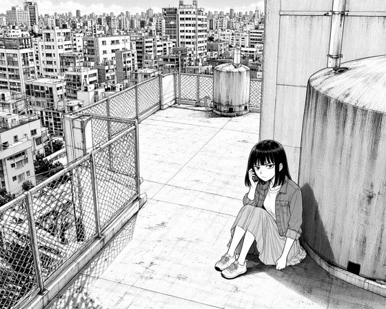
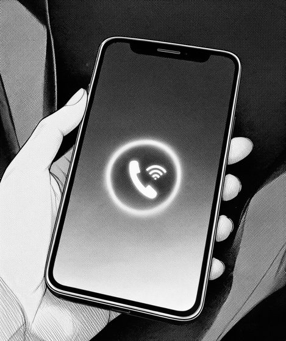
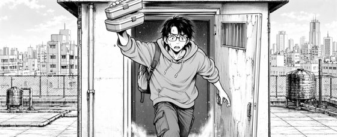
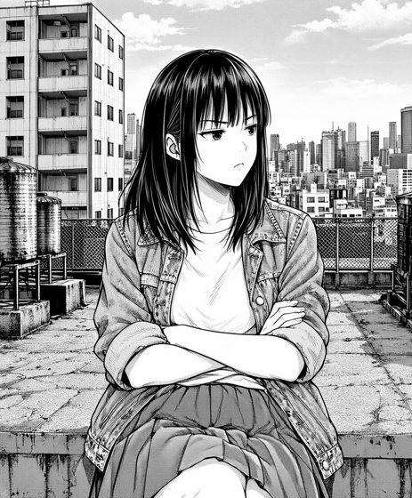
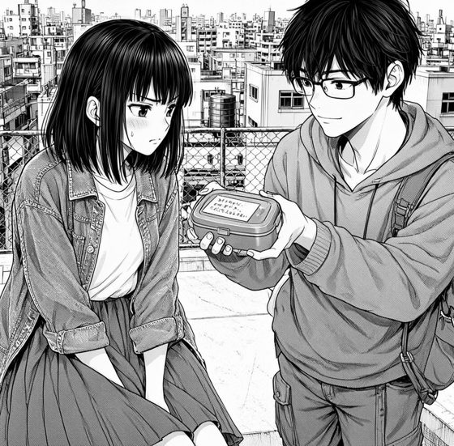
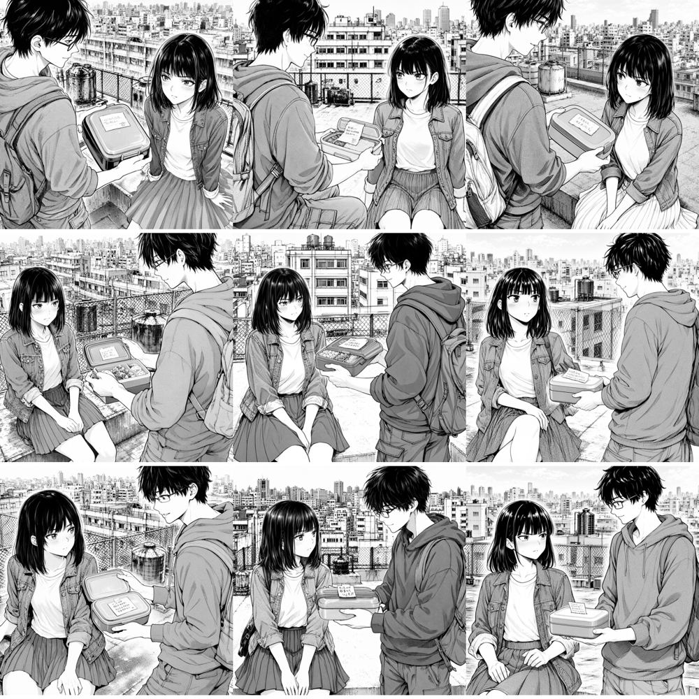
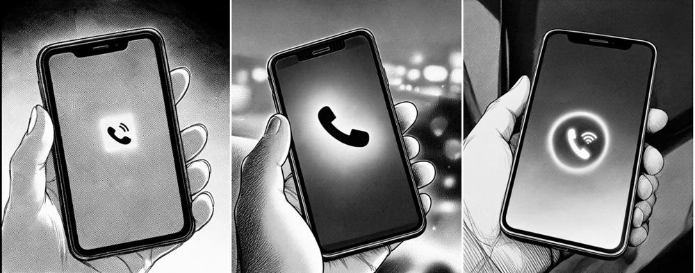
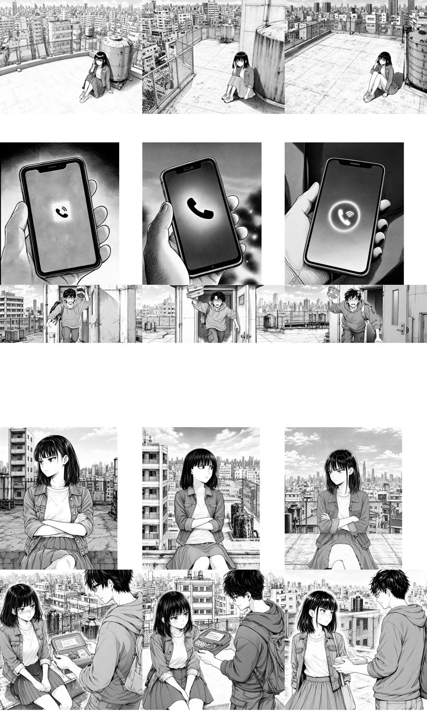
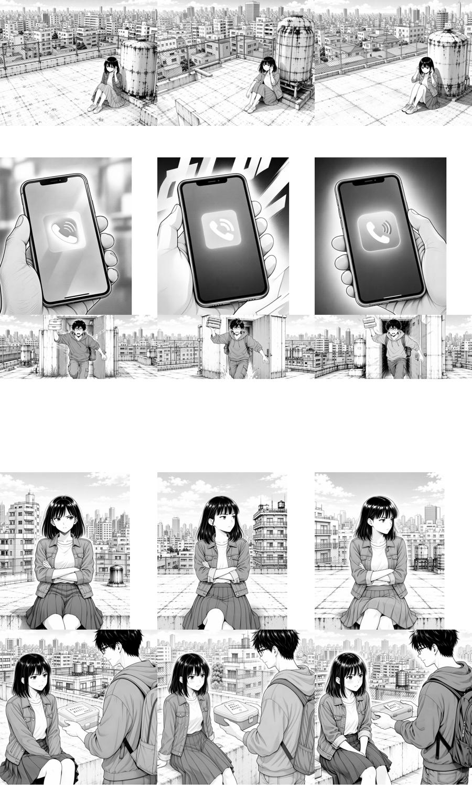

# S1 出圖實測（範例頁，每格 3 個 seed）

日期：2026-11-08｜範例：`examples/sample_comic` 第 1 章第 1 頁（模板 `5a`，5 格）｜共 15 張

> 狀態：**部分完成**。本檔涵蓋「每格 3 seed 的秒數、VRAM、角色跑錯格、多出文字、人數、黑白」、k5／k2 的 caption 變體比較（第 6 節），依結果修改 `compile.py` 與範例預設值後的整頁重跑（第 8 節），以及 25 步 vs 4-step LoRA 比較（第 9 節）。文字編碼器 GPU vs CPU 只測了 W4A8 版（第 10 節）；int8 版編碼器未安裝，**尚未測**。

## 1. 測試條件與做法

| 項目 | 內容 |
|---|---|
| 顯卡／ComfyUI | RTX 5070 Ti 16 GB（約 15.9 GiB 可用）、ComfyUI 0.41.0、啟動參數 `--disable-smart-memory --use-sage-attention` |
| 模型 | `moss_image_sft_int8_convrot`、`qwen3.5_9b_w4a8_gptq`（文字編碼器，GPU）、`flux2-vae_small` |
| 取樣 | 25 步、CFG 2.5（`workflows/moss_layout.api.json` 預設，未更動） |
| 尺寸 | 約 1 MP：k1 1120×896、k2 912×1088、k3 1568×640、k4 912×1104、k5 1008×992 |
| 提示詞 | `build/ch001/*.prompt.json`（caption 內含「The artwork has no speech bubbles, captions or lettering.」；負向提示詞含 `text, speech bubble, letters`） |
| seed | 依 `compile._seed(格 id, 0/1/2)`；前兩個與 `project.yaml` 的 `candidates: 2` 先前跑出的圖相同，第 3 個為本次補跑 |

**資料來源（請知悉）**

- 每格前 2 個 seed（10 張）是這次測試開始前就已經存在於 `renders/ch001/`，秒數取自 ComfyUI 的 `/history`（`execution_start`→`execution_success`）。
- 第 3 個 seed（5 張）由我透過瀏覽器對 ComfyUI 送出：沿用 `/history` 中同一格的 workflow，只換 seed 與檔名前綴（沒有透過 `tools/panels.py`，因為這次沒有可用的命令列）。圖原本存在 `E:\output\text2comics\s1_<格 id>_s<seed>_00001_.png`，已複製到 `renders/ch001/<格 id>_s<seed>.png`。
- 圖片是我逐張看過縮小後的版本判斷的；細節（小字、手指數）可能漏看，請你抽查。

## 2. 秒數

單位：秒，ComfyUI 執行時間（不含排隊）。

| 格 | seed 1 | seed 2 | seed 3 |
|---|---|---|---|
| k1 | 16.9（`1760676462`） | 12.5（`1390808158`） | 14.9（`1930524811`） |
| k2 | 14.2（`1928825640`） | 12.4（`2086180148`） | 14.3（`481952861`） |
| k3 | 14.9（`1428924568`） | 12.5（`1680250963`） | 14.7（`415192853`） |
| k4 | 14.9（`2075731333`） | 12.5（`94182253`） | 14.7（`69575219`） |
| k5 | 14.8（`1200410782`） | 12.5（`55936351`） | 14.9（`580952527`） |

- 15 張平均 **14.1 秒**；整頁 5 格 × 3 seed 約 **3.5 分鐘**。
- 同一格連續跑第 2 個 seed 時固定約 **12.5 秒**，換新提示詞的第一張約 **14.3–14.9 秒**，差約 2.4 秒。推測是文字編碼（Qwen 9B）的結果在同一提示詞連續執行時被快取；這是推論，沒有另外驗證。
- 本次補跑的第 3 個 seed 是在換了別格之後才跑，所以都落在 14–15 秒。**實務上同一格的 seed 連著跑比較省時間**（`tools/panels.py` 目前就是這個順序）。
- k1 seed 1 的 16.9 秒最高，是這批的第一張，可能含模型重新載入（未驗證）。

## 3. VRAM

在每張生成期間每 0.4 秒讀一次 `/system_stats` 的 `vram_free`，記錄最低值。

| 項目 | 數值 |
|---|---|
| GPU 總量 | 15.89 GiB |
| 閒置（尚未生成） | 已用 1.31 GiB（桌面與其他程式） |
| 生成中最低剩餘（5 張補跑，每張各自取最低） | 9.08–9.13 GiB |
| 換算：生成中 GPU 已用 | **約 6.8 GiB**（比閒置多約 5.5 GiB） |

- 這是**取樣的下限值**：取樣間隔 0.4 秒，可能漏掉 VAE 解碼瞬間的尖峰；`cudaMallocAsync` 下 `torch_vram_*` 沒有參考價值，所以只用 `vram_free`。
- `docs/01_架構與流程.md` 第 3 節寫「主模型＋文字編碼器約 13 GB」，實測遠低於此。推測是 `--disable-smart-memory` 讓文字編碼器在編碼後卸載、不與主模型同時佔用；未驗證。這個設定下 16 GB 卡**有很大餘裕**，S7 排程「LLM 與 ComfyUI 不同時佔 GPU」的前提不變。
- 前 10 張當時沒有量 VRAM。

## 4. 15 張逐張檢查

標記：✓ 正常；✗ 問題。「人數」指畫面上人物數與分鏡是否相符。

| 格（在場角色） | seed | 角色／位置 | 人數 | 多出的文字／圖形 | 其他 |
|---|---|---|---|---|---|
| k1（lin，右下） | `1760676462` | ✓ lin 右下、靠水塔 | ✓ 1 | 無 | |
| | `1390808158` | ✓ | ✓ 1 | 無 | 水塔遮陰最貼分鏡，構圖最好 |
| | `1930524811` | ✓ | ✓ 1 | 無 | lin 偏小 |
| k2（無人，手機特寫） | `1928825640` | — | ✓ 0 | **✗ 圖內畫了一圈黑色邊框** | 單手握機 ✓；螢幕是通話圖示，沒有字 |
| | `2086180148` | — | ✓ 0 | 無 | **✗ 雙手握機**（分鏡寫 a hand） |
| | `481952861` | — | ✓ 0 | 無（通話圖示＋類 Wi-Fi 波紋，不是字） | 單手 ✓；背景黑塊多 |
| k3（hao，中） | `1428924568` | ✓ hao | ✓ 1 | 無（沒有畫「碰！」） | 便當盒看起來疊了約 3 層（分鏡 2 個） |
| | `1680250963` | ✓ | ✓ 1 | 無 | 2 個便當盒 ✓ |
| | `415192853` | ✓ | ✓ 1 | 無 | 2 個便當盒 ✓ |
| k4（lin，中） | `2075731333` | ✓ | ✓ 1 | 無 | 表情最到位 |
| | `94182253` | ✓ | ✓ 1 | 無 | 頭髮偏短 |
| | `69575219` | ✓ | ✓ 1 | 無 | |
| k5（hao 右、lin 左） | `1200410782` | **✗ 左右對調**（hao 在左前景、lin 在右） | ✓ 2 | 便當蓋小紙條有假手寫字（分鏡要求有紙條） | over_shoulder ✓ |
| | `55936351` | ✓ lin 左、hao 右 | ✓ 2 | 同上，紙條字跡更小 | **✗ 未呈現 over_shoulder**（看得到 hao 的臉） |
| | `580952527` | **✗ 左右對調** | ✓ 2 | 同上 | over_shoulder ✓；lin 的裙子變白色細褶（外觀偏離） |

### 彙整

- **角色跑錯格**：沒有「不該在場的角色跑進來」（k2 無人、k3 只有 hao、k4 只有 lin 都對）。唯一問題是 **k5 的左右位置，3 張有 2 張對調**。
- **人數錯誤**：15 張都正確。「This panel shows exactly one person, and each person appears only once」這句在本樣本有效。
- **多出文字**：15 張**沒有任何對話框、旁白、標題、狀聲詞**。k3 沒有出現「碰！」（`sfx_mode: overlay` 運作正常）。例外只有 k5 紙條上的假手寫字，那是分鏡指定的物件，不是多出來的。
- **多出圖形**：k2 seed 1 圖內多畫了黑框，會與組版的畫框重疊，不能直接用。
- **外觀一致性**：lin（黑色及肩髮、齊瀏海、牛仔外套、百褶裙）與 hao（黑髮、眼鏡、連帽衫、背包）在 15 張中辨識度一致；唯一偏離是 k5 seed 3 的 lin 裙子偏白、k4 seed 2 頭髮偏短。
- **黑白**：用 Pillow 量了 15 張。RGB 三通道最大差平均 1.4–3.5（0–255），幾乎是灰階；**k2 三張較高（5.6–7.2，最大值到 58）**，是手機螢幕光暈的輕微偏色。灰階佔比（亮度 40–215）介於 36–61%，也就是不是純黑白二值，而是網點加灰階漸層。k2 的發光漸層與黑塊比較不像漫畫網點。

## 5. 挑選（初選，請你再看過）

縮圖在 `docs/qa/S1_picks/`；原圖在 `examples/sample_comic/renders/ch001/`（不進版控）。

| 格 | 選 | 備選 | 理由 |
|---|---|---|---|
| k1 | `1390808158` | `1760676462` | 構圖與分鏡最一致 |
| k2 | `481952861` | `2086180148` | 單手、無邊框；備選對比較乾淨但是雙手 |
| k3 | `1680250963` | `415192853` | 2 個便當盒、動作清楚 |
| k4 | `2075731333` | `69575219` | 表情到位 |
| k5 | `55936351` | `1200410782` | 左右位置正確；但沒有 over_shoulder，另一張有 over_shoulder 但左右相反 |

## 6. Caption 變體比較（k5 左右對調、k2 邊框）

針對第 4 節的兩個問題，**沿用同樣的 3 個 seed**、只改提示詞，各跑一次（12 張，每張約 12–15 秒）。做法同第 1 節：從 ComfyUI 紀錄取該格 workflow，改 layout JSON 後送出；圖放在 `examples/sample_comic/renders/s1_variants/`。每個變體每格只有 3 張，只能當跡象，不能當統計結論。

### k5（hao 該在右、lin 該在左）

| 變體 | 改了什麼 | 左右位置正確 | over_shoulder（hao 背對鏡頭） | 人數 | 多出文字 |
|---|---|---|---|---|---|
| 原版（第 4 節） | — | **1/3** | 2/3 | 3/3 | 無 |
| A　對調 box | hao 的 box 放左、lin 放右（其餘不變） | 3/3（照對調後的 box） | **3/3** | 3/3 | 無 |
| B　寫明左右 | 原 box；hao caption 前加 `He stands on the right side of the frame.`、lin 加 `She sits on the left side of the frame.` | **3/3** | 約 0–1/3（多為側面） | 3/3 | 無 |
| C　拿掉 over_shoulder | 原 box；`over-the-shoulder view` 改 `two-shot`，hao 的 `Seen from behind over his shoulder` 改 `Seen from the side` | **3/3** | 無（本來就不要） | 3/3 | 無 |

解讀（推論，樣本小）：

- 原版 2/3 對調，原因看起來是 `over_shoulder` 的慣例（背對鏡頭的人在前景左側）蓋過了 box。**A 是同時要左右位置和 over_shoulder 時最穩的**：分鏡上把「背對鏡頭的角色」放在左邊。
- 如果分鏡一定要 hao 在右，B、C 都能把位置拉回來，代價是失去 over_shoulder。
- 九張裡 lin 的外觀仍有小偏離（A 第 3 張裙子偏白色長褶），與第 4 節同一類，頻率沒有因變體而增加。

### k2（手機特寫：邊框、雙手）

| 變體 | 改了什麼 | 圖內邊框 | 單手 | 多出文字 |
|---|---|---|---|---|
| 原版 | — | 1/3 有 | 2/3 | 無 |
| D | summary 加 `The image has no border or frame.`；`a hand`→`one hand`；物件 caption `a woman's hand`→`one hand` | **0/3** | **3/3** | 無（只有通話圖示） |

- D 同時改了兩處，無法分開判斷哪一句有效。
- 光暈與漸層仍在（第 3 張背景還出現失焦光點），第 4 節對 k2 黑白的看法不變：靠後製轉灰階，不靠提示詞。

## 7. 結論與建議（第 3、4、5 項已套用，見第 8 節）

對應 `HANDOFF.md` 的待決問題：

1. **「The artwork has no speech bubbles, captions or lettering.」**：本樣本 15 張**沒有畫出字或對話框**，沒有看到反效果，可以先保留。限制：負向提示詞同時有 `text, speech bubble, letters`，無法分辨是誰的功勞；樣本只有 1 頁。若要確認，可關掉其中一個再各跑 3 seed。
2. **黑白網點**：多數格已有網點與灰階，幾乎無偏色。建議 S2 組版時**統一轉灰階**（成本低，可消除 k2 偏色）；是否加網點濾鏡或二值化，等你看過實際頁面再決定。k2 這類「發光螢幕」的格子漸層偏多，caption 可以加 `flat black and white, no glow`（未測）。
3. **k5 雙人格左右對調（原版 2/3）**：第 6 節已測。使用 `over_shoulder` 時，**分鏡把背對鏡頭的角色放左邊**（變體 A，3/3 位置與構圖都對）；一定要放右邊就在 caption 寫明左右（變體 B）或不用 over_shoulder（變體 C），都是 3/3 位置正確。`compile.py` 已改成：有 ≥2 個角色時，自動在每個角色 caption 前加 `He/She is on the left/right side of the frame.`（依 box 中心判斷），整頁重跑結果見第 8 節。
4. **k2 邊框與雙手**：第 6 節變體 D（加 `no border or frame`、改 `one hand`）3/3 都沒邊框、都是單手。`compile.py` 已改成每格 caption 固定加 `The image has no border or frame.`，整頁 15 張都沒有邊框（第 8 節）。
5. **每格 3 seed 的成本**：整頁約 3.5 分鐘，**不需要為了速度降到 2 個**。`project.yaml` 目前 `candidates: 2`；本次 15 張裡，k2、k5 各有 1 張明顯不能用，3 個候選較保險，已把範例 `project.yaml` 改成 `candidates: 3`。
6. **ComfyUI 版本**：`01_架構與流程.md` 寫需要 0.42.0 以上，本機是 0.41.0 且能正常出圖；文件這一句要更新。

## 8. 套用到程式後的整頁重跑（2026-11-08）

依第 7 節建議已修改：

| 檔案 | 改了什麼 |
|---|---|
| `t2c/compile.py` | 每格 summary 在「不要對話框」句前加 `The image has no border or frame.`；一格有 ≥2 個角色時，角色 caption 最前面加 `He/She is on the left/right side of the frame.`（依 box 中心：<0.4 左、>0.6 右） |
| `examples/sample_comic/project.yaml` | `candidates` 2 → 3 |
| `examples/sample_comic/storyboard/ch001.json` | 第 2 格 `a hand`／`a woman's hand` → `one hand` |
| `tests/test_core.py` | 新增 3 項；`pytest tests/test_core.py` 在雲端 Linux 21 項全過（原 18 項）。`tests/test_smoke.py` 需要 fastapi，沒跑 |
| `docs/02_資料格式.md`、`CHANGELOG.md` | 補充左右位置句與 0.1.1 紀錄 |

重新編譯後 5 格共 15 個 seed 與第 2 節完全相同（`_seed` 沒變），用新提示詞整頁重跑（圖在 `examples/sample_comic/renders/s1_rerun/`，新的 `build/ch001/*.prompt.json` 已更新）。

| 項目 | 修改前（第 4 節） | 修改後 |
|---|---|---|
| 人數正確 | 15/15 | 15/15 |
| 多出的對話框、旁白、狀聲詞 | 0/15 | 0/15（k5 紙條的假手寫字是分鏡指定的物件） |
| k2 圖內邊框 | 1/3 | **0/3**（整頁 0/15） |
| k2 單手 | 2/3 | **3/3** |
| k5 lin 左、hao 右 | 1/3 | **3/3** |
| k5 hao 背對鏡頭（over_shoulder） | 2/3 | 3 張都是斜後方／側面，沒有一張是完整背對；比修改前弱 |
| 外觀偏離 | k5 第 3 張裙子偏白、k4 第 2 張頭髮偏短 | k5 第 3 張 lin 的裙子變成長紗裙、姿勢像站著（分鏡是 Sitting）；其他沒看到 |
| k2 偏色（RGB 最大差平均） | 5.6–7.2 | 4.5–7.8（沒有改善，仍要靠後製轉灰階） |
| 秒數 | 平均 14.1 | 平均 13.2，整頁 15 張 198 秒（約 3.3 分鐘） |

- 這次整頁依 panel 連續跑，每格第 1 張約 14.5–15.1 秒、同格後面 2 張約 12.2–12.7 秒，與第 2 節「同一提示詞連續跑較快」一致。
- 取捨：左右位置句讓 k5 的位置穩了，代價是 hao 不再明確背對鏡頭。要完整 over_shoulder，就照第 6 節變體 A，在分鏡把背對鏡頭的角色 box 放左邊。
- 左右位置只有 k5 這一格有 2 個角色，**沒有在其他雙人格驗證**，也沒測 3 人以上。

## 9. 25 步 vs 4-step LoRA

LoRA：`moss_image_sft_4step_v2.0.safetensors`（1,189,176,752 bytes，來源 akhaliq/MOSS-Image-SFT-4-steps，Apache-2.0），放在 `i:\models\Z-image_lora\ANIMA`，ComfyUI 以 `ANIMA\moss_image_sft_4step_v2.0.safetensors` 列出。

做法：用第 8 節整頁重跑的同樣提示詞與 15 個 seed，在 workflow 的 `UNETLoader` 後接 `LoraLoaderModelOnly`（強度 1.0），`KSampler` 改成 4 步、CFG 1.0、`euler`／`simple`（LoRA 頁面建議值；負向提示詞在 CFG 1 時無效）。**同時改了 LoRA、步數、CFG、取樣器四項**，無法分開各自的影響。主模型仍是 `moss_image_sft_int8_convrot`、文字編碼器 `qwen3.5_9b_w4a8_gptq`（LoRA 頁面寫的搭配是 bf16 與 int8 版，本機不同）。圖在 `examples/sample_comic/renders/s1_lora4/`。

| 項目 | 25 步（第 8 節） | 4 步＋LoRA |
|---|---|---|
| 每張秒數 | 同格第 1 張約 14.5–15.1、之後約 12.2–12.7 | 同格第 1 張約 5.4–6.0、之後約 3.2–3.4 |
| 15 張平均／整頁總時間 | 13.2 秒／198 秒 | **4.1 秒／61 秒**（約快 3.3 倍） |
| 生成中最低剩餘 VRAM（取樣） | 9.08–9.13 GiB | 8.97–9.02 GiB（多用約 0.1 GiB） |
| 人數正確 | 15/15 | 15/15 |
| 多出的對話框、旁白、狀聲詞 | 0/15 | 0/15（k5 紙條的假手寫字是分鏡指定的物件） |
| 圖內邊框 | 0/15 | 0/15 |
| k2 單手 | 3/3 | 3/3 |
| k5 lin 左、hao 右 | 3/3 | 3/3；hao 都帶出背包與肩線，比 25 步更接近背對鏡頭 |
| 外觀偏離（lin 的裙子、姿勢） | k5 第 3 張裙子與姿勢偏離 | 這 15 張沒看到 |
| RGB 偏色（最大差的平均） | 2.9 | 2.1 |
| 灰階佔比（亮度 40–215） | 47.0% | 45.4% |

**LoRA 有沒有套滿**：LoRA 載入後 ComfyUI 的紀錄是 `MOSSImage … 168 patches attached`。為了看有沒有 `lora key not loaded`，我改強度為 0.9999 重新載入一次（第一次載入的紀錄已被紀錄緩衝捲掉，只留最後 300 行），這次載入的紀錄裡**沒有**該行。限制：我只能讀 `/internal/logs/raw` 的內容，沒有 168 這個數字是否為模型全部可套用層數的對照，所以只能說「沒看到未載入警告」，不能說「確定 100% 套用」。

**畫面差異（我的主觀判斷，請你自己看）**
- 4 步的線條更乾淨、背景細節與透視更完整，沒有 25 步那種髒髒的粗糙筆觸；代價是網點和墨線的「漫畫感」變少，灰階漸層變多。
- k2（手機）三張都變成圓角 App 圖示加柔光背景，其中一張出現放射狀速度線，另一張背景失焦。這格 25 步版本也偏光暈，不算新問題。
- 沒有測 6、8 步與 3 步 LoRA（LoRA 頁面說大於 1024² 時 4 步會偏霧；本頁格子都約 1 MP，沒有看到霧感）。

**建議與已實作**：用 4 步＋LoRA 產候選與初稿（一格 3 個 seed 約 12 秒），挑定後再用 25 步重畫定稿。已做成「出圖預設」（`config.json` 的 `comfy.presets`／`comfy.default_preset`，`final`＝原 workflow、`draft`＝4 步＋LoRA；`tools/panels.py` 新增 `--preset`、`--seed`；非預設的預設，檔名加 `_<預設名>` 後綴）。程式產生的 `draft` workflow 送你的 ComfyUI 實跑一次（k1、seed 1390808158），ComfyUI 沒有回報節點錯誤，輸出與第 9 節手動版**逐像素相同**（最大差 0）。沒有動 `project.yaml`、分鏡與聖經的格式。注意：同一個 seed 的草稿與定稿是**不同的圖**，定稿要重新確認；說明見 `docs/03_建置與環境.md` 4.3–4.4。

附帶：ComfyUI 每次收到我送的 API 提示詞，都會印一條 `Exception in prompt seed update`，出自 `custom_nodes\focus_node` 的 on_prompt 處理，不影響出圖，與本專案無關。

## 10. 文字編碼器 GPU vs CPU（W4A8 版）

做法：把 `CLIPLoader` 的 `device` 設成 `cpu`，其餘與 25 步 workflow 相同，送 k1、seed 1390808158。ComfyUI 的 `device` 只有 `default`／`cpu` 兩個選項；目前只裝了 W4A8 編碼器。

| 項目 | GPU（default） | CPU |
|---|---|---|
| 新提示詞的執行時間 | 約 14.5 秒 | **175.4 秒** |
| 同提示詞的第二個 seed（條件已快取） | 約 12.4 秒 | 12.6 秒 |
| 取樣期間最低可用 VRAM | 9.08 GiB | 9.08 GiB |

- CPU 的額外代價（約 160 秒）發生在**每個新提示詞一次**，同一格的後續 seed 不用再付；一頁 5 格就是約 13 分鐘的額外等待。
- **VRAM 沒有省**：ComfyUI 以 `--disable-smart-memory` 啟動，編碼器用完本來就會卸載，所以放 CPU 對最低可用 VRAM 沒有影響。
- 同 seed 的 CPU 與 GPU 圖逐像素不同（46.8% 的像素差大於 8），因為數值路徑不同；並排看（`docs/qa/S1_picks/cpu_vs_gpu.png`）構圖、人物、姿勢與氣氛一致，我看不出品質差異，只是細節不同。
- 結論：W4A8 在 CPU 上約慢 12 倍且沒有 VRAM 好處，**不建議**。只有 GPU 要和 llama.cpp 共用時才有意義，那時應先卸載 llama.cpp，而不是搬編碼器。docs 建議的「int8 版＋CPU」沒有實測，要測得先下載 `qwen3.5_9b_int8_convrot.safetensors`（很大）。

## 11. 尚未完成的 S1 項目

- int8 編碼器＋CPU 的公平比較（要下載 int8 版，需要你同意）。
- 4 步與 25 步的差異目前只有一頁 5 格；是否把 4 步當預設，要你看過圖後決定。
- 雙人格、三人格的左右位置句要用更多分鏡再驗證。
- `tests/test_smoke.py`（需 fastapi）與 Windows 上的 `pytest` 還沒跑；git 尚未提交。
- 更新 `docs/01_架構與流程.md` 第 2、3 節。
- `docs/00_階段計畫.md` 的 S1 狀態欄維持「待做」，等上面做完再改。
